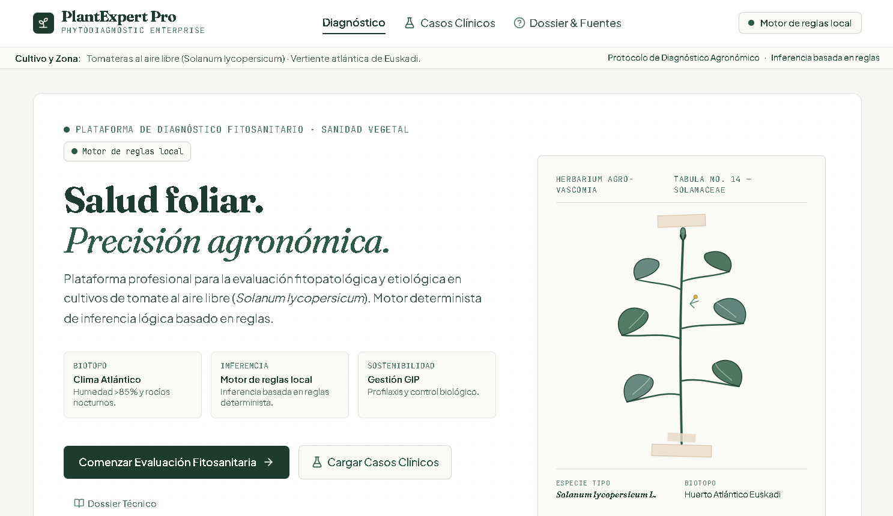
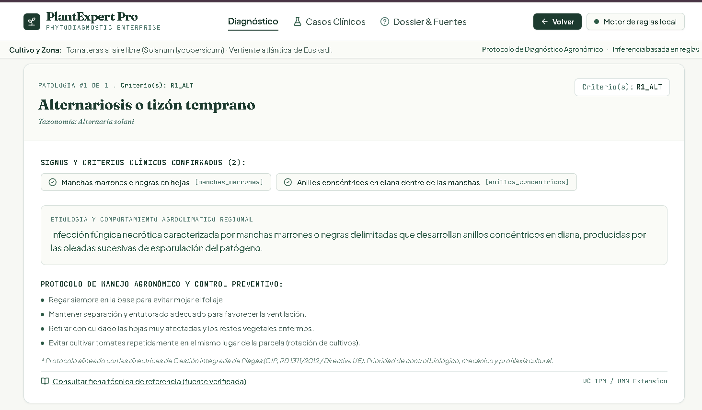
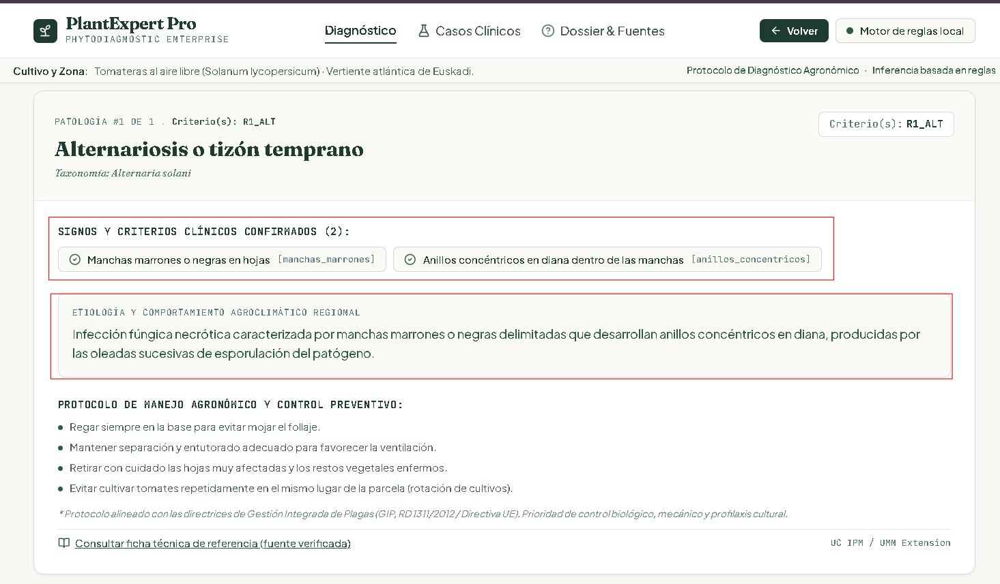
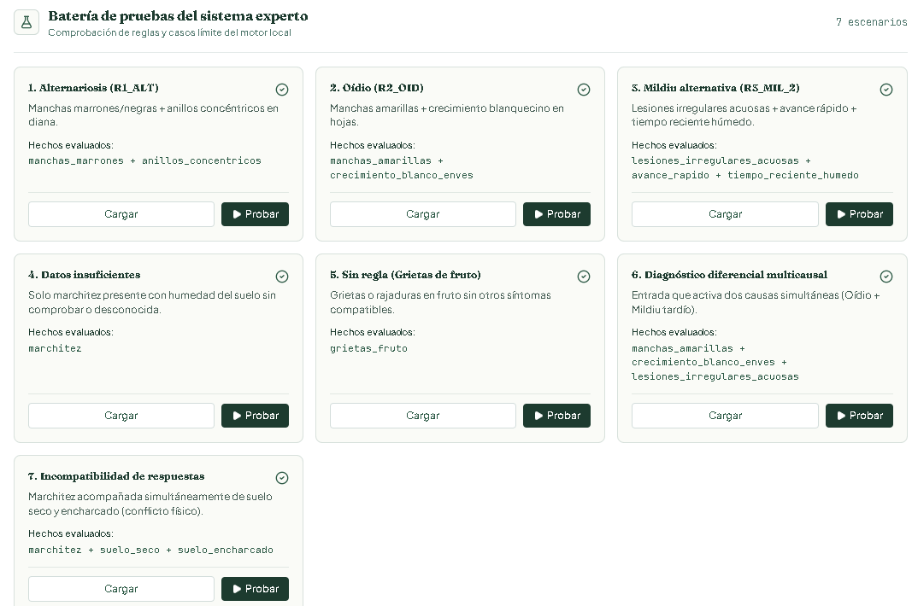

# PlantExpert Pro

**Sistema experto para el diagnóstico de enfermedades y problemas del cultivo de tomate.**

## 1. Introducción

PlantExpert Pro es una aplicación web que ayuda a identificar posibles enfermedades y problemas en tomateras a partir de los síntomas que observa el usuario.

El usuario responde a un cuestionario sobre las hojas, los frutos y el riego. El sistema analiza las respuestas mediante un conjunto de reglas y muestra posibles causas, explicaciones y recomendaciones.

El proyecto está centrado en tomateras al aire libre (*Solanum lycopersicum*), tomando como referencia las condiciones de la vertiente atlántica de Euskadi.

## 2. Objetivo y usuarios

El objetivo es desarrollar un sistema experto que ayude a orientar el diagnóstico de problemas habituales en las tomateras.

Está dirigido principalmente a personas aficionadas a la jardinería que necesitan ayuda para reconocer posibles problemas en sus plantas.

PlantExpert Pro ofrece resultados orientativos. No sustituye el diagnóstico de un técnico agrícola ni garantiza la identificación definitiva de una enfermedad.

## 3. Acceso a la aplicación

**Aplicación publicada:** https://piantexpert.ai.studio

**Repositorio de GitHub:** https://github.com/nainis90/PIant_Expert


## 4. Ejemplo de uso

El funcionamiento de PlantExpert Pro es sencillo:

1. El usuario abre la aplicación.
2. Comienza una evaluación fitosanitaria.
3. Responde las preguntas sobre los síntomas de su tomatera.
4. Puede seleccionar «Sí», «No» o «No lo sé».
5. El motor analiza las respuestas y aplica las reglas.
6. La aplicación muestra las posibles causas y explica el resultado.

**Captura 1. Pantalla principal y cuestionario**

<!-- SUSTITUIR POR UNA CAPTURA REAL DE LA APLICACIÓN -->



**Captura 2. Ejemplo de diagnóstico**

<!-- SUSTITUIR POR UNA CAPTURA REAL DE UN DIAGNÓSTICO -->



## 5. Problemas que contempla

El sistema trabaja con seis grupos de problemas:

- Alternariosis o tizón temprano.
- Oídio.
- Mildiu tardío.
- Mancha bacteriana.
- Problemas de riego, como falta o exceso de agua.
- Carencias y problemas nutricionales.

## 6. Los cinco componentes del sistema experto

### 6.1. Interfaz de usuario

Desarrollada con React y TypeScript. Permite responder preguntas sobre los síntomas de la planta y consultar los resultados.

### 6.2. Base de conocimiento

Contiene los hechos, síntomas y reglas relacionados con los problemas del cultivo de tomate. La información se ha preparado a partir de fuentes agronómicas.

### 6.3. Motor de inferencia

Está desarrollado en TypeScript. Analiza las respuestas del usuario y las compara con las reglas disponibles para obtener posibles diagnósticos.

### 6.4. Sistema de explicación

Muestra los síntomas relacionados con el resultado, las reglas activadas, las posibles causas y las fuentes de información.

### 6.5. Adquisición de conocimiento

El proyecto establece un procedimiento para añadir nuevos problemas, síntomas y reglas. Antes de incorporarlos, se deben revisar las fuentes, comprobar posibles contradicciones y realizar pruebas.

La actualización del conocimiento se realiza desde los archivos del proyecto, no desde un formulario de la aplicación.

## 7. Base de conocimiento y reglas

El sistema utiliza reglas del tipo:

**SI** se cumplen determinados síntomas, **ENTONCES** se considera una posible causa.

Estas son las reglas implementadas en el motor local:

| Regla | Posible causa | Síntomas |
|---|---|---|
| R1_ALT | Alternariosis | Manchas marrones y anillos concéntricos. |
| R2_OID | Oídio | Manchas amarillas y crecimiento blanco en las hojas. |
| R3_MIL_1 | Mildiu tardío | Lesiones acuosas y crecimiento blanco en el envés. |
| R3_MIL_2 | Mildiu tardío | Lesiones acuosas, avance rápido y tiempo húmedo. |
| R4_BAC_1 | Mancha bacteriana | Manchas pequeñas oscuras y halo amarillo. |
| R4_BAC_2 | Mancha bacteriana | Lesiones ásperas y oscuras en el fruto. |
| R5_SEQ | Falta de agua | Marchitez y suelo seco. |
| R6_EXC | Exceso de agua o problema radicular | Marchitez y suelo encharcado. |
| R7_NUT | Problema nutricional | Amarilleo y patrón de amarilleo entre las hojas. |

Las reglas permiten relacionar los síntomas con posibles causas. No representan una confirmación definitiva de la enfermedad.

## 8. Funcionamiento del motor y casos especiales

El motor de inferencia analiza los hechos afirmativos y comprueba qué reglas se cumplen.

También contempla estas situaciones:

- **Información insuficiente:** faltan datos para obtener una posible conclusión.
- **Diagnóstico diferencial:** varias reglas se cumplen y aparecen distintas causas posibles.
- **Respuestas incompatibles:** detecta respuestas contradictorias, como indicar que el suelo está seco y encharcado al mismo tiempo.
- **Ninguna regla encaja:** los síntomas indicados no coinciden con las reglas disponibles.

**Captura 3. Explicación de un resultado**

<!-- SUSTITUIR POR UNA CAPTURA REAL DONDE SE VEAN LAS REGLAS Y LA EXPLICACIÓN -->



## 9. Pruebas del sistema

La aplicación incluye siete escenarios para comprobar el funcionamiento del motor:

1. Alternariosis.
2. Oídio.
3. Mildiu tardío.
4. Datos insuficientes.
5. Caso sin regla compatible: grietas en el fruto.
6. Diagnóstico diferencial con varias causas.
7. Respuestas incompatibles.

Estas pruebas permiten comprobar tanto los casos habituales como algunas situaciones problemáticas.

**Captura 4. Barra de pruebas**

<!-- SUSTITUIR POR UNA CAPTURA REAL DE LOS SIETE ESCENARIOS -->



**Captura 5. Resultado de un caso problemático**

<!-- SUSTITUIR POR UNA CAPTURA REAL DE UN CASO LÍMITE -->


## 10. Tecnologías utilizadas

- **Google AI Studio:** entorno utilizado para desarrollar la aplicación.
- **React:** creación de la interfaz.
- **TypeScript:** programación de la aplicación y del motor de reglas.
- **Vite:** herramienta utilizada para ejecutar y compilar el proyecto.
- **Tailwind CSS:** diseño y estilos de la interfaz.
- **GitHub:** almacenamiento y publicación del código.

### Nota sobre Prolog

El repositorio también incluye el archivo `prolog/plantexpert.pl`, creado durante el desarrollo.

Sin embargo, el diagnóstico principal de la aplicación se realiza con el motor de reglas local desarrollado en TypeScript. No se necesita conectar un servidor SWI-Prolog para utilizar ese diagnóstico.

## 11. Instalación y ejecución

Para ejecutar el proyecto en un ordenador se necesita tener instalado Node.js y npm.

1. Descargar o clonar este repositorio.
2. Abrir una terminal dentro de la carpeta del proyecto.
3. Instalar las dependencias:

```bash
npm install
```

4. Iniciar la aplicación:

```bash
npm run dev
```

5. Abrir en el navegador la dirección local que aparece en la terminal.

## 12. Fuentes de información

La base de conocimiento se ha elaborado consultando fuentes de información agronómica sobre enfermedades y problemas del cultivo de tomate.

Las fuentes utilizadas se relacionan con los síntomas, las reglas y las recomendaciones incluidas en el sistema.

**Fuentes consultadas:**

- [UC IPM](https://ipm.ucanr.edu/)
- [University of Minnesota Extension](https://extension.umn.edu/)
- [Ministerio de Agricultura, Pesca y Alimentación](https://www.mapa.gob.es/)

## 13. Limitaciones

- El sistema está diseñado para problemas seleccionados del cultivo de tomate.
- No analiza fotografías de las plantas.
- No contempla todas las enfermedades y problemas posibles.
- Algunos síntomas pueden coincidir entre distintas causas.
- Las recomendaciones son orientativas.
- Los resultados deben comprobarse antes de tomar decisiones sobre el cultivo.

---

**PlantExpert Pro**  
Sistema experto para orientar el diagnóstico de problemas en tomateras.
