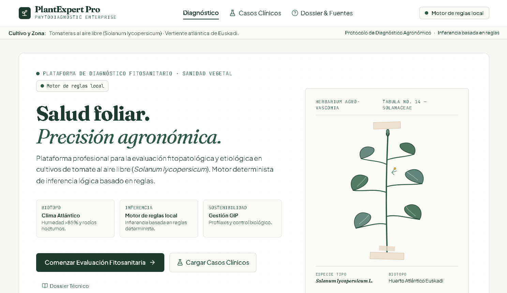
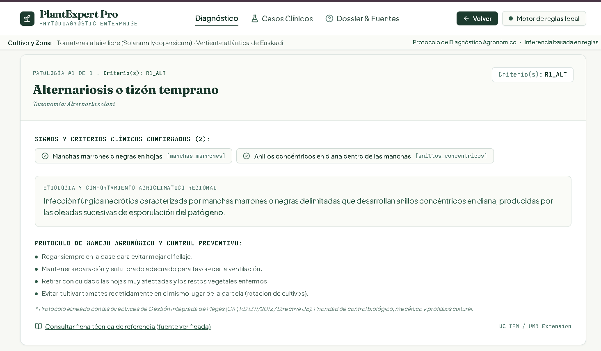
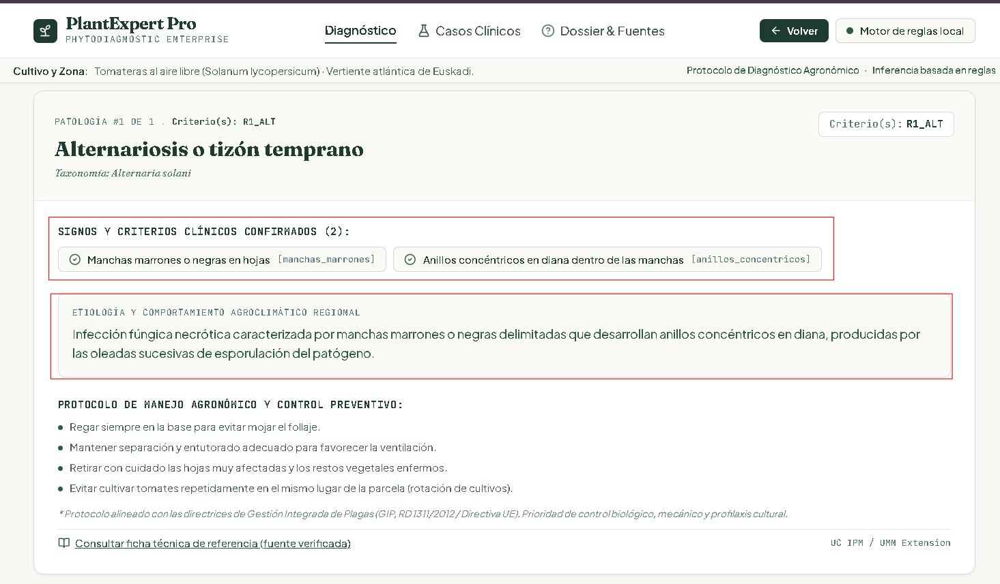
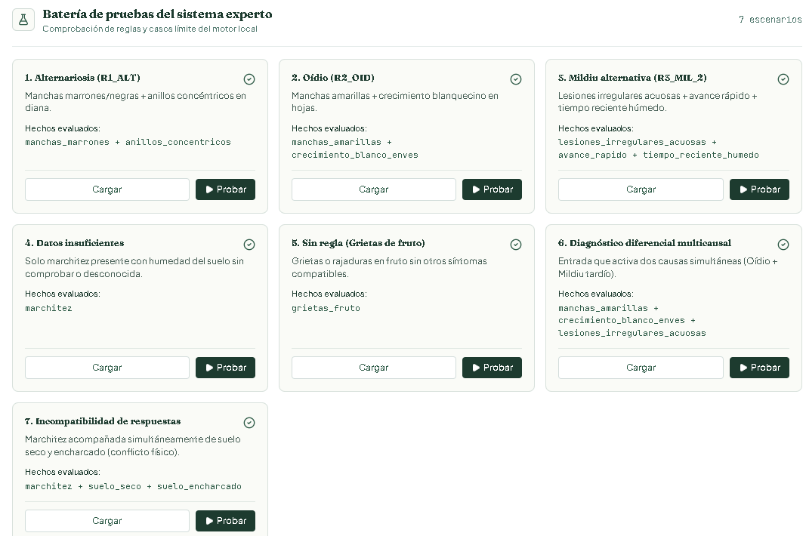
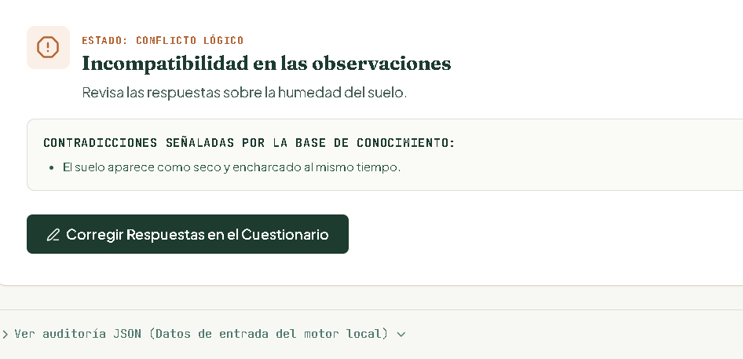

# PlantExpert Pro

**Sistema experto para el diagnóstico de enfermedades y problemas del cultivo de tomate.**

## 1. Introducción

PlantExpert Pro es una aplicación web que ayuda a identificar posibles enfermedades y problemas en tomateras a partir de los síntomas que observa el usuario.

El usuario responde a preguntas sobre las hojas, los frutos y el riego. El sistema analiza las respuestas con un conjunto de reglas y muestra posibles causas, explicaciones y recomendaciones.

El proyecto se centra en tomateras al aire libre (*Solanum lycopersicum*), tomando como referencia las condiciones de la vertiente atlántica de Euskadi.

## 2. Objetivo y usuarios

El objetivo es crear un sistema experto que ayude a reconocer posibles problemas habituales en las tomateras.

Está pensado principalmente para personas aficionadas a la jardinería que necesitan ayuda para reconocer qué puede estar pasando con sus plantas.

PlantExpert Pro ofrece resultados orientativos. No sustituye el diagnóstico de un técnico agrícola ni garantiza que la enfermedad identificada sea la correcta.

## 3. Acceso a la aplicación

**Aplicación publicada:** [PlantExpert Pro](https://piantexpert.ai.studio)

**Repositorio de GitHub:** [PlantExpert Pro](https://github.com/nainis90/PIant_Expert)

## 4. Ejemplo de uso

El funcionamiento de PlantExpert Pro es sencillo:

1. El usuario abre la aplicación.
2. Comienza una evaluación fitosanitaria.
3. Responde las preguntas sobre los síntomas de su tomatera.
4. Puede seleccionar «Sí», «No» o «No lo sé».
5. El motor analiza las respuestas y aplica las reglas.
6. La aplicación muestra las posibles causas y explica el resultado.

**Captura 1. Pantalla principal y cuestionario**



**Captura 2. Ejemplo de diagnóstico**



## 5. Problemas que contempla

El sistema trabaja con seis grupos de problemas:

- Alternariosis o tizón temprano.
- Oídio.
- Mildiu tardío.
- Mancha bacteriana.
- Problemas de riego, como falta o exceso de agua.
- Carencias y problemas nutricionales.

## 6. Los cinco componentes del sistema experto

### 6.1. Interfaz de usuario

Está desarrollada con React y TypeScript. Nos permite responder preguntas sobre los síntomas de la planta y consultar los resultados.

### 6.2. Base de conocimiento

Tiene los hechos, síntomas y reglas que tienen relación con los problemas del cultivo de tomate. La información se ha preparado a partir de fuentes agronómicas.

### 6.3. Motor de inferencia

Está desarrollado en TypeScript. Analiza las respuestas del usuario y las compara con las reglas disponibles para obtener posibles diagnósticos.

### 6.4. Sistema de explicación

Muestra los síntomas que coinciden, las reglas activadas, las posibles causas y las fuentes de información.

### 6.5. Adquisición de conocimiento

En el proyecto se pueden añadir nuevos problemas, síntomas y reglas. Antes de meterlos, hay que revisar las fuentes, comprobar que no haya contradicciones y hacer pruebas.

La actualización del conocimiento se hace desde los archivos del proyecto, no desde un formulario de la aplicación.

## 7. Base de conocimiento y reglas

El sistema usa reglas del tipo:

**SI** se cumplen determinados síntomas, **ENTONCES** se considera una posible causa.

Estas son las reglas que utiliza el motor local:

| Regla | Posible causa | Síntomas |
|---|---|---|
| R1_ALT | Alternariosis | Manchas marrones y anillos concéntricos. |
| R2_OID | Oídio | Manchas amarillas y crecimiento blanco en las hojas. |
| R3_MIL_1 | Mildiu tardío | Lesiones acuosas y crecimiento blanco en el envés. |
| R3_MIL_2 | Mildiu tardío | Lesiones acuosas, avance rápido y tiempo húmedo. |
| R4_BAC_1 | Mancha bacteriana | Manchas pequeñas oscuras y halo amarillo. |
| R4_BAC_2 | Mancha bacteriana | Lesiones ásperas y oscuras en el fruto. |
| R5_SEQ | Falta de agua | Marchitez y suelo seco. |
| R6_EXC | Exceso de agua o problema radicular | Marchitez y suelo encharcado. |
| R7_NUT | Problema nutricional | Amarilleo y patrón de amarilleo entre las hojas. |

Las reglas relacionan los síntomas con posibles causas. No confirman por sí solas que la planta tenga una enfermedad.

## 8. Funcionamiento del motor y casos especiales

El motor analiza los hechos afirmativos y comprueba qué reglas se cumplen.

También tiene en cuenta estas situaciones:

- **Información insuficiente:** faltan datos para obtener un posible diagnóstico.
- **Diagnóstico diferencial:** se cumplen varias reglas y aparecen distintas causas posibles.
- **Respuestas incompatibles:** detecta respuestas contradictorias, como indicar que el suelo está seco y encharcado al mismo tiempo.
- **Ninguna regla encaja:** los síntomas indicados no coinciden con las reglas disponibles.

**Captura 3. Explicación de un resultado**



## 9. Pruebas del sistema

La aplicación incluye siete escenarios para comprobar cómo funciona el motor:

1. Alternariosis.
2. Oídio.
3. Mildiu tardío.
4. Datos insuficientes.
5. Caso sin regla compatible: grietas en el fruto.
6. Diagnóstico diferencial con varias causas.
7. Respuestas incompatibles.

Estas pruebas permiten comprobar cómo responde el sistema tanto en casos habituales como en situaciones problemáticas.

**Captura 4. Barra de pruebas**



**Captura 5. Resultado de un caso problemático**



## 10. Tecnologías utilizadas

- **Google AI Studio:** entorno que hemos utilizado para desarrollar la aplicación.
- **React:** lo utilizamos para crear la interfaz.
- **TypeScript:** lo utilizamos para programar la aplicación y el motor de reglas.
- **Vite:** lo utilizamos para ejecutar y compilar el proyecto.
- **Tailwind CSS:** lo utilizamos para los estilos de la aplicación.
- **GitHub:** lo utilizamos para guardar y compartir el código.

### Nota sobre Prolog

El repositorio también tiene el archivo `prolog/plantexpert.pl`, que creamos durante el desarrollo.

Pero el diagnóstico principal de la aplicación se hace con el motor de reglas local desarrollado en TypeScript. No hace falta conectar un servidor SWI-Prolog para utilizar el diagnóstico.

## 11. Instalación y ejecución

Para ejecutar el proyecto en un ordenador hay que tener instalado Node.js y npm.

1. Descargar o clonar este repositorio.
2. Abrir una terminal dentro de la carpeta del proyecto.
3. Instalar las dependencias:

```bash
npm install
```

4. Iniciar la aplicación:

```bash
npm run dev
```

5. Abrir en el navegador la dirección local que aparece en la terminal.

## 12. Fuentes de información

Para crear la base de conocimiento hemos consultado fuentes de información agronómica sobre enfermedades y problemas del cultivo de tomate.

Estas fuentes nos han servido para conocer los síntomas y preparar las reglas del sistema.

**Fuentes consultadas:**

- [UC IPM](https://ipm.ucanr.edu/)
- [University of Minnesota Extension](https://extension.umn.edu/)
- [Ministerio de Agricultura, Pesca y Alimentación](https://www.mapa.gob.es/)

## 13. Limitaciones

- El sistema está pensado para algunos problemas concretos del cultivo de tomate.
- No analiza fotografías de las plantas.
- No contempla todas las enfermedades ni todos los problemas posibles.
- Algunos síntomas pueden coincidir entre distintas causas.
- Las recomendaciones sirven como orientación.
- Los resultados deben revisarse antes de tomar decisiones sobre el cultivo.

---

**PlantExpert Pro**

Sistema experto para orientar el diagnóstico de problemas en tomateras.
